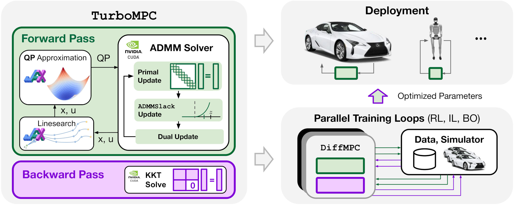

# TurboMPC

## Fast, Scalable, and Differentiable Model Predictive Control on the GPU

This repository contains code for [TurboMPC: Fast, Scalable, and Differentiable Model Predictive Control on the GPU](https://arxiv.org/abs/2606.24039) by Gabriel Bravo-Palacios, Jianghan Zhang, Zachary Pestrikov, Brian Plancher, and Thomas Lew.

TurboMPC uses sequential quadratic programming (SQP), the Alternating Direction Method of Multipliers (ADMM), and structured linear system solvers such as Eigen and NVIDIA cuDSS to exploit problem structure and enable efficient, batchable, and differentiable solves on the GPU.


## Installation

Tested with Python 3.10+ on Ubuntu 22.04.

The Eigen backend requires Eigen headers: `sudo apt install libeigen3-dev`.

We recommend working in a virtual environment:
```
python -m venv .venv
source .venv/bin/activate
```
and running `source .venv/bin/activate` before any other python command.


### CPU-only (no GPU required)

```bash
python -m pip install -e .
```

### GPU (CUDA)

Prerequisites: CUDA 12, CMake >= 3.20, and an NVIDIA driver compatible with your CUDA toolkit.

```bash
python -m pip install -e ".[cuda12]"
```


`[cuda12]` selects GPU runtime dependencies. Whether the CUDA kernels are
compiled is controlled by the environment `TURBOMPC_CUDA` (`AUTO` by default, see
[docs/build_guide.md](docs/build_guide.md)).


### Check install
Verify the install with:
```
turbompc-check
```
Expected output on a fully-built install on a machine with a GPU:
```
JAX: 0.6.2, devices: [CudaDevice(id=0)]
cuSolver: OK
turbompc: OK
fused_pcg FFI: OK
fused_cudss FFI: OK
pcg FFI: OK
cudss FFI: OK
cudss KKT FFI: OK
Eigen backend: OK
```

### Troubleshooting
For manual builds, build options, and troubleshooting, see
[docs/build_guide.md](docs/build_guide.md).


## Usage

See [docs/API.md](docs/API.md) for the API, including problem
setup, solver construction, backend selection, warm starts, and
differentiating through MPC solves.

## Examples
For examples on how to use TurboMPC, refer to:

* Drone obstacle avoidance planning example: [examples/drone_obstacles.ipynb](examples/drone_obstacles.ipynb)
* Spacecraft RL example: [examples/RL_spacecraft.ipynb](examples/RL_spacecraft.ipynb)
* Quadrotor RL example: [examples/RL_quadrotor.ipynb](examples/RL_quadrotor.ipynb)
* Drone obstacle training with SHAC: [examples/rl/drone_obstacle_training.ipynb](examples/rl/drone_obstacle_training.ipynb)
* Neural network cost function RL: [examples/pointmass_rl.ipynb](examples/pointmass_rl/pointmass_rl.ipynb)
* Racing RL with SHAC: [examples/rl/racing_training.ipynb](examples/rl/racing_training.ipynb)

## Benchmarking

Scripts are in [benchmarking](benchmarking/README.md). The
linear system suite compares TurboMPC, mpc.pytorch, and acados.

## Testing

```bash
python -m pytest tests                             # default suite
python -m pytest tests/python                      # CPU/Python subset
python -m pytest tests/cuda                        # CUDA/backend subset
python -m pytest --run-extended tests              # default + extended
python -m pytest --run-extended -m extended tests  # extended only
```

For the optional RL checks, install PyTorch and Diffrax using the `rl` extra
declared in [pyproject.toml](pyproject.toml). Run from the repository root:

```bash
python -m pip install -e '.[rl]'
JAX_PLATFORMS=cpu python -m pytest examples/rl/test/test_rl.py
```

## Acknowledgments
Many thanks to:
- Bassam ul Haq for simplifying the installation,
- Jonathan Frey for [optimizing the CasADi comparison script](https://github.com/ToyotaResearchInstitute/turbompc/pull/5),
- Emre Adabag, Marcus Greiff, and John Subosits for prior work on [diffmpc](https://github.com/ToyotaResearchInstitute/diffmpc).

## References
```bibtex
@unpublished{SmoothedTurboMPC2026,
  author       = {Zhang, Jianghan and Schwan, Roland and Bravo-Palacios, Gabriel and Zhang, John and Lew, Thomas and Plancher, Brian},
  title        = {Efficient Learning of Differentiable {MPC} Policies on the {GPU} via Smoothed {ADMM} and First-Order Reinforcement Learning},
  year         = {2026},
  note         = {Available at \url{https://arxiv.org/abs/2606.24039}}
}

@unpublished{TurboMPC2026,
  author       = {Bravo-Palacios, Gabriel and Zhang, Jianghan and Pestrikov, Zachary and Plancher, Brian and Lew, Thomas},
  title        = {{TurboMPC}: Fast, Scalable, and Differentiable Model Predictive Control on the {GPU}},
  year         = {2026},
  note         = {Available at \url{https://arxiv.org/abs/2606.24039}}
}

@article{ADMMSlack2026,
  author       = {Lew, Thomas and Greiff, Marcus and Subosits, John and Plancher, Brian},
  title        = {Solving Quadratic Programs with Slack Variables via {ADMM} without Increasing the Problem Size},
  year         = {2026},
  journal      = {{European Journal of Control}}
}
```
